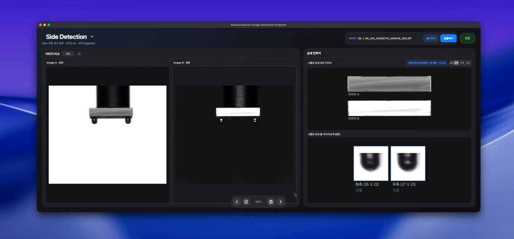
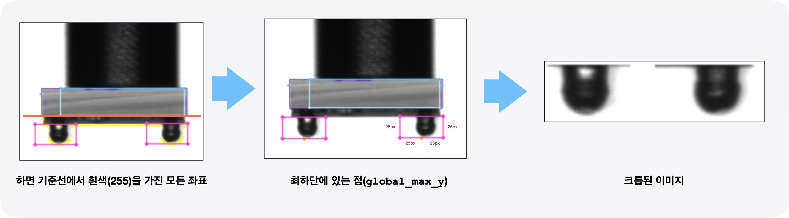

# 반도체 칩 표면 검사 프로그램

[English](README.md) | [한국어](README_KO.md)

> 반도체 칩(Die)의 상면, 하면, 좌측면 및 우측면 결함을 빠르게 검출하기 위한 OpenCV 기반 프로그램입니다.



## 배경
본 레포지토리 연구는 객체 검출 AI 모델을 전체 검사 과정에 단독으로 적용하지 않고, Rule-Based Computer Vision과 여러가지의 Vision 모델을 결합한 구조입니다. 이를 통해 고해상도 영상 처리에 따른 컴퓨팅의 부담을 줄이고, 검사 속도와 정확도 뿐만 아니라 판정 근거의 추적성과 유지보수성을 함께 확보할 수 있습니다. 최근 반도체 제조사 및 검사 장비 업체에서도 공개했던 Human-in-the-loop, 고속 검사-정밀 Review, Rule-AI 계층화 사례와도 일치합니다.

## 현재 기능

### 측면 검사

측면 검사는 **칩의 표면과 숄더 볼(숄더 범프)** 의  손상 여부를 확인 합니다.
먼저, B 페이지를 그레이스케일로 변환하고 임계값을 적용해 표면 컨투어를 추출합니다.

#### 표면 검사
   - 상·하·좌·우 가장자리에서 처음 닿는 접점을 측정합니다.
   - 접점의 빈도와 밀집도 분포를 바탕으로 상·하면 커팅 기준선을 선택하여 측면의 미세한 회전이나 불균일한 컨투어 형상을 보정합니다.
   - A 페이지에서 별도의 기둥 기준을 계산하고, 두 기준 방식을 A/B 페이지의 동일한 좌표에 적용해 크롭 결과를 비교합니다.

#### 숄더 볼 검사

   2-1. `find_downward_contour_white_points`
      - B 페이지에서 얻은 표면 하면 좌표를 시작점으로 아래방향으로 증가시켜 흰색(255)을 가진 위치들을 모두 탐색하여 수집한다.
      - 이떄, 표면 하면 기준선 보다 5px 이상 아래에 위치한 지점(`SCAN_START_OFFSET=5`)만 수집한다. (하면 아래 손상이나 빛비침 여부로 인해 흰색이 된 지점 배제하기 위함)

   2-2. `get_distant_bottommost_points`
      - 흰색 픽셀들 중에서 전체 최하단에 있는 점(`global_max_y`)을 구한다.(볼 가장 하단)
      - 조건으로, y축으로 10px, x축으로 40px 떨어진 지점에서 새로운 하단점을 선정

   2-3. `get_ball_square_bounds`, `draw_ball_squares`
      - 선정된 볼 최하단점을 기준으로 바운딩 박스를 그려 UI에 전달

   > 옵션) 원호 정밀 측정 및 윤곽 검증(`ball_arc.measure_ball_arcs`)
      > - Canny 엣지 추출, 피팅 수행하여 반경, 오차, 윤곽선, 대칭성을 계산



### 하면 검사 · 칩 위치와 원 후보

> 칩 좌상단 꼭짓점에서 가로 비율(`fx`)과 세로 비율(`fy`)을 조합해 6개 ROI의 예상 중심을 정한다.
> ROI 크기와 원 후보의 면적·중심거리 조건은 칩 크기 대비 비율로 검사한다.

1. 이진화 작업 및 칩 위치 찾기

   1-1. `find_bottom_chip`, `_binarize`, `_locate_bottom_chip`
      - 배경 밝기와 Otsu 임계값을 함께 사용해 회색 칩을 이진화한다.
      - 사각형에 가까운 가장 큰 칩 윤곽에서 4개 모서리(`chip.corners`), 중심, 회전각, 칩 마스크를 구한다.

   1-2. `find_circle_regions`
      - 좌상단 모서리에서 `fx`, `fy` 비율로 6개 ROI의 예상 중심을 계산한다. 위치는 좌·우 `10%`, 상·중·하 `10%·50%·90%`이다.
      - 칩의 상단·좌측 변 벡터에 `23.53%`를 곱해 ROI를 만든다. 따라서 칩이 회전하거나 확대·축소되면 ROI도 같은 방향과 비율로 변한다.
      - 각 ROI에서 검은 성분의 실제 윤곽을 찾고, 면적·원형도·종횡비·예상 중심과의 거리를 측정한다.
      - 원 후보는 원형도 `0.80` 이상, 종횡비 `0.70` 이상, 칩 대비 면적 `0.93%~1.56%`, 칩 폭 대비 중심거리 `7.06%` 이하를 만족해야 한다. 검색 경계 접촉 또는 복수 후보는 검토 대상으로 남긴다.

   1-3. `draw_circle_regions`, `create_circle_roi_preview`
      - 원 후보·검토·미검출 상태에 맞는 색으로 ROI와 실제 윤곽을 표시한다.
      - 여섯 ROI를 3열 × 2행 타일로 정렬하고 각 위치의 원형도와 면적을 표시한다.

      > - 면적 : 칩과 원의 면적을 각각 구한뒤 비율을 계산함 `circle // chip * 100`
      > - 원형도 : 면적 / 둘레 `(4 * pi * 면적) / 둘레 ^ 2`
      > - 종횡비 : 원의 가로 세로 비율로 비슷해야 함
      > - 예상 중심과 실제 중심의 거리 차이 `(중심 거리 // 칩 폭 * 100)`


### 상면 표면 검사

_추후 지원 예정_

## 프로젝트 구조

```text
├── app.py               # PyQt5 애플리케이션 실행 (--dark, --install-desktop-entry 옵션)
├── ui.py                # 메인 화면 레이아웃, 상태 및 사용자 상호작용
├── ui_components.py     # 이미지·모달 공용 위젯, SVG 아이콘
├── styles.py            # 라이트·다크 UI 스타일, 아이콘·캡션 색
├── general.py           # 이미지 입출력, 캡처 경로, 메모, 파일명 라벨(OK/NG/DK)
├── contour.py           # 검출 방식에 독립적인 컨투어 추출과 기하 계산
├── bottom/
│   ├── pipeline.py      # A 기반 이진화·칩 위치·원 후보 흐름
│   └── circles.py       # 6개 ROI·검은 성분·원 후보 조건과 표시
├── side/
│   ├── pipeline.py      # 전체 Side 검출 흐름 조립
│   ├── surface.py       # 측면 표면 검출 및 크롭 미리보기
│   ├── surface_crop.py  # 학습 데이터 생성과 추론이 함께 쓰는 표면 Crop 타일
│   ├── ball.py          # 측면 볼 검출
│   ├── ball_arc.py      # 숄더 볼 하단 원호 측정
│   ├── classifier.py    # 표면 OK/NG 분류 CNN
│   ├── detection.py     # 표면 결함 Object Detection (Faster R-CNN)
│   └── segmenter.py     # 표면 결함 분할 U-Net
├── tools/               # 학습·평가 스크립트 (아래 "학습·평가 도구" 참고)
│   ├── data/            # 학습 데이터셋 만들기
│   ├── train/           # 모델 학습
│   ├── eval/            # 모델 평가
│   ├── results/         # 평가 결과 정리
│   └── CNN_guide.md     # 데이터 생성 → 학습 → 평가 상세 가이드
├── models/              # 학습된 모델(.pt)과 설정·그래프·평가 결과 (비공개)
├── assets/              # 애플리케이션 아이콘, 버튼 SVG 아이콘 및 기타 리소스
├── requirements.txt     # Python 의존성
└── dataset/             # 검사 이미지 데이터 (비공개)
```

실행 중 만들어지는 파일:

- `captures/` : 화면 캡처 JPG (`captures/{시각}/{원본파일명}_{번호}.jpg`)
- `notes.csv` : 이미지별 메모

## 요구 사항

- Python 3.10–3.12 권장
- 입력 `TIFF` 이미지는 크기가 동일한 A/B 페이지를 포함해야 합니다. 특정 데이터셋 형식을 전제로 합니다.

## 데이터셋과 모델

> **검사 이미지 데이터셋(`dataset/`)과 학습된 모델(`models/`)은 현재 연구 진행 중이므로 공개하지 않습니다.**

- 이 저장소에는 검사 프로그램과 학습·평가 코드만 포함되어 있습니다.
- 프로그램을 실행해 보려면 A/B 두 페이지로 된 TIFF 이미지를 직접 준비해 `불러오기`로 엽니다.
- `tools/` 스크립트의 기본 경로와 예시 명령은 비공개 데이터셋·모델을 기준으로 작성되어 있습니다. 직접 준비한 데이터로 실행할 때는 입력 폴더와 `--data`, `--model`, `--output` 등의 옵션으로 경로를 지정합니다.

## 설치

프로젝트를 받은 후 다음 명령을 실행합니다.

### MacOS / Linux

```bash
git clone https://github.com/dongwoodustinkang/die-detection.git
cd die-detection
python3 -m venv .venv
source .venv/bin/activate
python -m pip install --upgrade pip
python -m pip install -r requirements.txt
```

### Windows PowerShell

```powershell
git clone https://github.com/dongwoodustinkang/die-detection.git
cd die-detection
py -m venv .venv
.\.venv\Scripts\Activate.ps1
python -m pip install --upgrade pip
python -m pip install -r requirements.txt
```

## 실행

```bash
python app.py
```

다크 모드로 실행하려면 `--dark` 옵션을 붙입니다.

```bash
python app.py --dark
```

Linux의 GNOME(Wayland) 등 일부 데스크톱은 `.desktop` 파일로 앱 아이콘을 찾으므로, 독·작업 표시줄에 아이콘이 기본 모양으로 보이면 사용할 가상환경에서 한 번만 다음을 실행합니다. 프로젝트 폴더나 가상환경 위치를 옮기면 다시 실행합니다.

```bash
python app.py --install-desktop-entry
```

### 화면 사용법

| 동작 | 방법 |
|---|---|
| 검사 모드 변경 | 왼쪽 위 제목(`Side Detection` ▾)을 눌러 Side / Bottom / Top 선택 |
| 이미지 불러오기 | `불러오기` → TIFF 파일 여러 개 또는 폴더 하나 선택 |
| 다시 검출 | `검출하기` |
| 이미지 이동 | 키보드 `←` / `→` 또는 아래쪽 이동 막대의 이전·다음 버튼 |
| 메모 | 이동 막대의 메모 버튼 (`notes.csv`에 저장) |
| 화면 캡처 | 이동 막대의 카메라 버튼 (`captures/`에 저장) |
| 이미지 크게 보기 | 결과 이미지나 미리보기를 클릭 |
| 프로그램 종료 | `Esc` |

헤더 오른쪽 라벨은 **파일명** 기준의 정답 라벨이며, 검출 결과가 아닙니다.

| 라벨 | 조건 |
|---|---|
| `NG` (불량) | 파일명에 `NG`가 있음 |
| `OK` (정상) | 파일명에 `OK`가 있음 (`NG`가 함께 있으면 `NG`) |
| `DK` (알 수 없음) | 둘 다 없음 |

## 학습·평가 도구 (tools)

측면 표면 결함 모델(분류 CNN, Faster R-CNN, U-Net)을 위한 스크립트입니다. 저장소 루트에서 실행합니다.

| 폴더 | 스크립트 | 역할 |
|---|---|---|
| `tools/data/` | `make_data.py` | 표면 Crop 타일로 분류용 train/val/test 데이터셋 생성 |
| | `make_sg_data.py` | NG 마스크로 분할(U-Net) 데이터셋 생성 |
| | `make_od_data.py` | NG 마스크로 Object Detection(박스) 데이터셋 생성 |
| `tools/train/` | `train_classifier.py` | 표면 OK/NG 분류 CNN 학습 |
| | `train_segmenter.py` | 표면 결함 분할 U-Net 학습 |
| | `train_detection.py` | 표면 결함 Faster R-CNN 학습 |
| | `train_graphs.py` | 학습 그래프 저장 (다른 학습 스크립트에서 사용) |
| `tools/eval/` | `eval_classifier.py` | 분류 CNN 평가 |
| | `eval_segmenter.py` | U-Net 평가 |
| | `eval_detection.py` | Faster R-CNN 평가 |
| `tools/results/` | `summarize_results.py` | 모델 × 평가셋 정확도 CSV 정리 |
| | `export_errors.py` | 오분류 CSV의 원본·크롭 이미지를 `dataset/errors/`로 모음 |

예시 (데이터셋·모델 경로는 비공개이므로 [데이터셋과 모델](#데이터셋과-모델)을 참고해 바꿔 지정합니다):

```bash
python tools/data/make_data.py --overwrite
python tools/train/train_classifier.py
python tools/eval/eval_classifier.py --model models/Classifier/side_surface_cnnA_102211.pt
```

각 스크립트의 옵션은 `--help`로 확인합니다. 학습 스크립트는 `requirements.txt` 외에 `matplotlib`, Faster R-CNN은 `torchvision`이 추가로 필요합니다. 

> 이 저장소는 특정 실험 연구를 위해 제작된 프로그램이므로 다른 프로젝트에는 적합하지 않을 수 있습니다.
